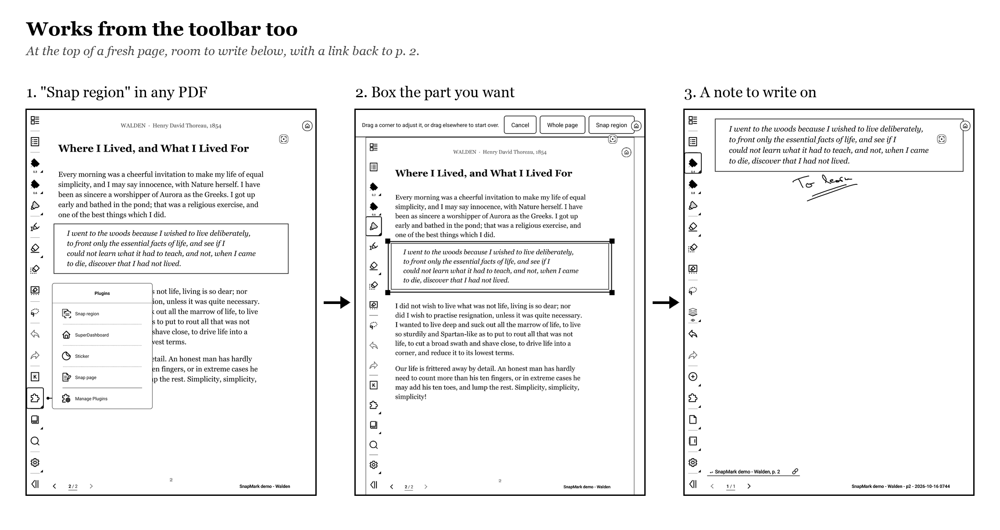
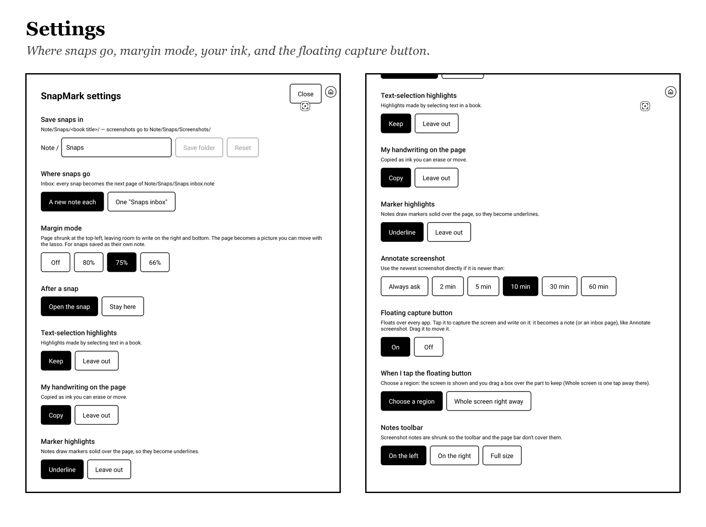

# SnapMark how-to

SnapMark is a Supernote plugin that turns what's on your screen into a note you can write on. That can be a page of a PDF or EPUB, a screenshot, or anything in any app.

- [What you need](#what-you-need)
- [Install](#install)
- [First run](#first-run)
- [Snap a document page](#snap-a-document-page)
- [Snap part of a page](#snap-part-of-a-page)
- [The floating capture button](#the-floating-capture-button)
- [Choosing a region](#choosing-a-region)
- [Annotate a screenshot](#annotate-a-screenshot)
- [Insert a screenshot into a note](#insert-a-screenshot-into-a-note)
- [Export a note page as PNG](#export-a-note-page-as-png)
- [Settings](#settings)
- [Where your snaps are saved](#where-your-snaps-are-saved)
- [Update](#update)
- [Uninstall](#uninstall)
- [Privacy and permissions](#privacy-and-permissions)
- [Troubleshooting](#troubleshooting)
- [Known limitations](#known-limitations)
- [Report a problem](#report-a-problem)

## What you need

- **A Supernote with plugin support.** The firmware must have the plugin permission system: **Chauvet 3.29.43 or later** on Manta and Nomad, or **2.26.40 or later** on A5 X and A6 X. You can check your version in the device's Settings.
- **Tested devices:** SnapMark is tested on a **Manta** only. It's written to work on other models, but they are untested. Reports are welcome.

## Install

1. Download `SnapMark-v<version>.snplg` from the [latest release](../../releases/latest).
2. Copy it into the **`MyStyle`** folder on your Supernote, using a USB cable or the Supernote Partner app.
   - On a Mac, a USB copy needs an MTP app such as OpenMTP.
3. On the Supernote, go to **Settings → Apps → Plugins → Choose Installation Package** and pick the file.
   - On some firmware this is called **Add Plugin**.

## First run

The first time you use a SnapMark button, it shows **"SnapMark needs file access"**. Tap **Continue**, then **Always allow** in the system dialog. SnapMark needs file access to save your snaps as notes.

SnapMark's buttons are in the **plugin menu of the side toolbar**:

| In a document (PDF, EPUB) | In a note |
|---|---|
| **Snap page**, **Snap region** | **Annotate screenshot**, **Insert screenshot**, **Export page as PNG** |

The **floating capture button** is separate and off by default; see below.

## Snap a document page

In a PDF or EPUB, tap **Snap page**. In about 3–4 seconds a new note opens with:

- **the page** as its background, ready to write on;
- **your handwriting** from the document page, copied as real ink you can erase and move;
- **text-selection highlights** you made in the book (setting: keep or leave out);
- **marker highlights** turned into thin underlines (the Notes app would draw a marker solid over the text);
- **a link at the bottom**, `↩ <Book>, p. N`, that opens the book on that page again.

With **After a snap → Stay here**, the note is saved and you stay on the page. With **Margin mode**, the page is shrunk to 80/75/66% at the top-left, leaving room to write on the right and below.

## Snap part of a page



In a PDF or EPUB, tap **Snap region** and [drag a box](#choosing-a-region) over the paragraph, verse or chart you want. The new note gets:
- **that part of the page at the top**, enlarged up to 2× if it's small, with the rest of the page free to write on;
- **your handwriting inside the box**, still real ink you can erase and move;
- the `↩ <Book>, p. N` link back to the page.

**Whole page** on the same screen does a normal Snap page.

## Paste into the note you're working in

Reading a PDF alongside a note of your own? Set **Where snaps go → Into the note I'm working in**. Then after **Snap region** (or a tap on the floating button):
- Notes comes back with **the note it last had open**, on the page you were on;
- the cut-out is placed on that page as a **picture**, at the size you saw it, **below what's already on the page**. If there's no room, it goes on a new page right after. Lasso it to move or resize it;
- from a PDF or EPUB, a `↩ <Book>, p. N` link goes just under it. From another app, a small caption says where and when it came from, for example `Kindle · 16 Oct 2026, 15:07`.

Things to know:
- Open your note in Notes first. If Notes has no note open, SnapMark asks you to open one rather than guessing.
- Your handwriting and highlights inside the box are **part of the picture**, not separate ink.
- **Whole screen** from the floating button pastes the whole screen. In a PDF or EPUB, **Whole page** and Snap page still make a note of their own, as do the screenshot buttons.
- **After a snap → Stay here** pastes and brings you back to the app or document you were in.

## The floating capture button

Turn it on in SnapMark's settings (**Floating capture button → On**). A small button with a viewfinder icon then floats over everything: notes, documents, Kindle, the browser, Settings.

- **Tap it** (finger or pen) to capture the screen. By default you then [drag a box](#choosing-a-region) over the part you want; **Whole screen** keeps all of it. About a second later Notes opens a new note with it, ready to write on. The button itself is never in the capture.
- **In a PDF or EPUB it works like Snap region:** the cut comes from the page itself and your handwriting stays editable.
- **Drag it** to move it. It stays where you leave it, also after a restart.
- **Where to keep it:** by default it sits on the **file name at the bottom right** of a note.
  - Supernote's pen writes on the page underneath any button, so a pen tap on the button over a page also leaves a dot of ink.
  - On the file name (or on the toolbar), the pen doesn't write, so keep it there.
  - A finger tap never writes.
- **Skip the selection screen:** in the settings, set **When I tap the floating button → Whole screen right away**.
- **Notes toolbar:** the capture is shrunk slightly so the toolbar and the page bar don't cover it. Set **Notes toolbar** to the side your toolbar is on, or to **Full size**.
- **The note is named after where you were:**
  - `<app name> - <time>` from any app, for example `eBiblia - 2026-10-15 1231`;
  - `<Book> - p<N> - <time>` from a PDF or EPUB. These also get the `↩ <Book>, p. N` link back to the page;
  - `<note title> - <time>` from a note.
- **After a snap** applies here too: **Open the snap** opens the new note; **Stay here** saves it and brings you back to the app you were in.
- **Where snaps go → One "Snaps inbox"** turns each capture into the next page of your inbox notebook instead of a new note. **Into the note I'm working in** [pastes it into your open note](#paste-into-the-note-youre-working-in).

## Choosing a region


After **Snap region** or a tap on the floating button, you see the page or screen as it was:
- **Drag** with your finger or the pen to draw a box. Drag a corner to adjust it, or drag elsewhere to start over.
- **Snap region** keeps that part.
- **Whole screen** (or **Whole page** in a document) keeps everything.
- **Cancel** goes back to where you were.

While this screen is up, the pen draws boxes, not ink. On e-ink the box follows your finger with a little delay; that's the display's refresh speed.

## Annotate a screenshot

Prefer Supernote's own screenshot? Take one as usual, anywhere. Then open any note and tap **Annotate screenshot**:

- If the newest screenshot is recent (10 minutes by default, adjustable), it becomes a new note right away.
- Otherwise a picker shows your latest 12 screenshots; tap one.

## Insert a screenshot into a note

In a note, tap **Insert screenshot**. The newest (or picked) screenshot is placed on the **current page** as a picture, at about 70% of the page and centered. Lasso it to move or resize it, and write around or over it.

## Export a note page as PNG

In any note, tap **Export page as PNG**. The current page, with all your writing, is saved as `EXPORT/<note title> - p<N>.png` at full resolution. It's ready to send to a computer or share.

## Settings

Open them from **Settings → Apps → Plugins → SnapMark**, then SnapMark's settings button. Every change is saved immediately.



| Setting | What it does |
|---|---|
| Save snaps in | The folder under `Note/` (default `Snaps`) |
| Where snaps go | **A new note each**; **One "Snaps inbox"**: every snap becomes the next page of one notebook; or **Into the note I'm working in**: region snaps are [pasted onto the open note's page](#paste-into-the-note-youre-working-in) |
| Margin mode | Page snaps shrunk to 80/75/66% with room to write (own-note snaps only) |
| After a snap | **Open the snap**, or **Stay here** (save and keep reading) |
| Text-selection highlights | Keep them in the page image, or leave them out |
| My handwriting on the page | Copy it as ink, or leave it out |
| Marker highlights | Turn them into underlines, or leave them out |
| Annotate screenshot | How recent a screenshot must be to use it without the picker |
| Floating capture button | On / Off |
| When I tap the floating button | **Choose a region** (default) or **Whole screen right away** |
| Notes toolbar | Which side your Notes toolbar is on (so captures aren't covered), or Full size |

## Where your snaps are saved

| What | Where |
|---|---|
| Page snaps | `Note/Snaps/<Book title>/<Book> - p<N> - <time>.note` |
| Screenshots and floating-button captures | `Note/Snaps/Screenshots/` |
| The inbox (collect mode) | `Note/Snaps/Snaps inbox.note` |
| PNG exports | `EXPORT/` |

`Snaps` is the default folder; you can change it in the settings. Two snaps in the same minute get ` (2)`, ` (3)`…

## Update

1. Install the new `.snplg` over the old one, the same way you installed it.
2. **Restart your Supernote afterwards.** The floating button runs native code, and the old version keeps running until the plugin system restarts.

Your settings are kept.

## Uninstall

1. Turn the **Floating capture button** off first.
2. Remove SnapMark in **Settings → Apps → Plugins**.

If the button is still on screen after uninstalling, tap it once or restart the device and it goes away. Your snaps are normal notes and stay where they are.

## Privacy and permissions

- **Access:** SnapMark asks only for **file access** (read and write). It has **no internet access**; nothing leaves your device.
- **Why it can capture the screen:** the floating button is native code. It runs inside Supernote's plugin system, and that system already has the rights to draw over other apps and to read the screen. So capturing needs no extra permission prompt.
- **What the native code does:**
  - shows the button;
  - captures the screen **only when you tap it**;
  - checks which app is in front;
  - brings Notes, or the app you came from, back to the front;
  - opens a note.
- **Open source:** you can check all of this in [the source](SnapMark/android/app/src/main/java/com/snapmark/SnapMarkNativeModule.java).

## Troubleshooting

| You see | What to do |
|---|---|
| The floating button doesn't appear after turning it on | Open any note once. If it's still missing, restart the device. |
| "Still working on the last snap…" | A snap is in progress; wait a moment. It resets on its own after a minute if something got stuck. |
| "Close the plugin screen first" | You tapped the floating button while a plugin's own screen was open. Close it and tap again. |
| "Could not bring up the Notes app" | Open any note once, then tap the button again. |
| The capture is partly under the toolbar | Set **Notes toolbar** to the side your toolbar is on. |
| A pen tap on the floating button left a dot of ink | Drag the button onto the file name at the bottom right of the note; the pen doesn't write there. |
| A whole-page snap comes out smaller, at the top-left | **Margin mode** is on in the settings; set it to Off for full-size pages. |
| "SnapMark has no file access" | Allow it in **Settings → Apps → Plugins → SnapMark → Permissions**. |
| "… is encrypted and locked" | Your snaps folder is in a locked folder. Unlock it in Files, or choose another folder. |
| After an update, the floating button acts like the old version | Restart the device (see [Update](#update)). |

## Known limitations

- **Devices:** tested on a Manta only.
- **Not yet tested on the device:**
  - landscape captures;
  - "Stay here" and the inbox with the floating button.
- **Speed:** a page snap takes 3–4 s. An inbox snap takes 5–6 s, because the Notes app has to reload the open notebook.
- **Drawing the box** on e-ink lags slightly behind your finger.
- **Pen taps on the floating button** over a page also write a dot there (see [where to keep it](#the-floating-capture-button)). In a PDF the safe spots aren't known yet.
- **Margin mode** copies your strokes but not shapes from the page.
- **Annotate screenshot** can't tell where a native screenshot came from, so those notes are named `Screenshot - <time>`.

## Report a problem

Open an issue on GitHub. Please include:
- your device and firmware version;
- the SnapMark version (Settings → Apps → Plugins);
- what you tapped;
- what happened.

If you're comfortable with `adb`, a log helps a lot:

```bash
adb logcat -v time | grep -E 'SnapMark|AndroidRuntime'
```

## Support SnapMark

SnapMark is free. If it saves you time, you can [buy me a coffee on Ko-fi](https://ko-fi.com/chrisxoxz).
