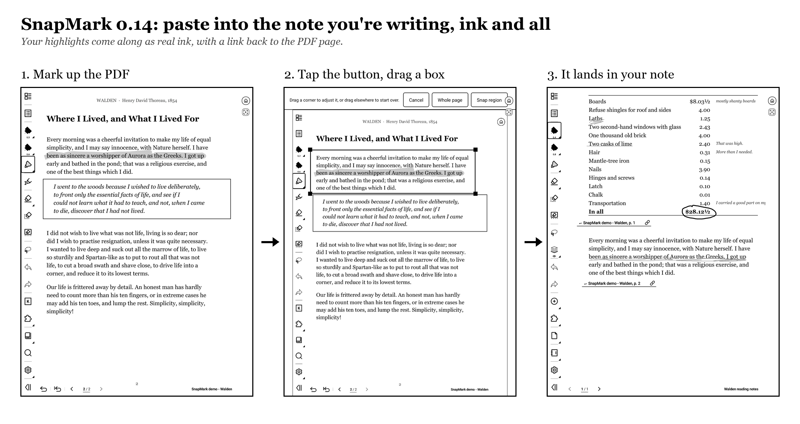

# SnapMark for Supernote

**Turn what's on your screen into a note you can write on, in one tap.**

SnapMark is a free, open-source plugin for Supernote e-ink devices. Website: **[snapmark.ink](https://snapmark.ink)**.

- **Snap page** (in a PDF or EPUB): the page becomes a new note, with your handwriting copied as editable ink, highlights kept, and a `↩` link back to the page.
- **Snap region:** drag a box (or tap two corners) over a paragraph, verse or chart. Just that part goes at the top of a new note, enlarged, with room to write below. From a PDF, your ink inside the box stays editable.
- **Floating capture button:** a small button that floats over every app (Kindle, the browser, a PDF, anything). Tap it, drag a box (or keep the whole screen), and about a second later you're writing on a note made from it.
- **Annotate screenshot:** a Supernote screenshot becomes a new note.
- **Insert screenshot:** a screenshot goes onto the page you're on, as a picture.
- **Export page as PNG:** the current note page, with your writing, saved as an image.
- **Paste into your note (optional):** a region snap goes onto the page of the note you're working in, with your handwriting as real ink and a link back to the PDF page.
- **Snaps inbox (optional):** collect every snap as the next page of one notebook instead of a note each.
- **Capture queue:** box several parts while you read (tap **Queue**), then paste them all into your note at once, with their ink and links.
- **Searchable snaps:** a snap from a PDF or EPUB carries a `Book p. N` keyword and the text it shows (on a hidden layer), so Supernote's Search finds it.
- **Undo last snap** (in Notes): takes back the last paste or inbox page.

Everything stays on your device: no account, no internet access.

## Download and install

1. Download `SnapMark-v<version>.snplg` from the **[latest release](../../releases/latest)**.
2. Copy it into the `MyStyle` folder on your Supernote (USB or the Partner app).
3. On the device: **Settings → Apps → Plugins → Choose Installation Package** and pick the file.

**[How-to guide](HOWTO.md)**: every feature, the settings, updating, privacy, troubleshooting.

**Requirements:** firmware with plugin support (Chauvet 3.29.43 or later on Manta and Nomad, 2.26.40 or later on A5 X and A6 X). Since 0.13.0 SnapMark is built with Supernote's plugin library 0.1.65, which every firmware with plugin support accepts; if yours still says SnapMark "is not compatible with the current system version", please [report it](https://github.com/traderchrisdev/SnapMark/issues/new/choose). **Works on the Manta and the Nomad:** every release is tested on a Manta, and a Nomad owner has confirmed it there. The A5 X and A6 X should work but are untested.

## For developers

- **Building:** the plugin's source and build instructions are in [`SnapMark/`](SnapMark/README.md). It's React Native 0.79 with `sn-plugin-lib`, plus a small Java module for the floating button and screen capture.
- **Design notes:** [`SPIKES.md`](SPIKES.md) records the experiments behind every design decision, including undocumented PluginHost behaviour, which may be useful if you write your own plugin. [`SPEC.md`](SPEC.md) is the original plan.

## Support

SnapMark is free. If it saves you time, you can [buy me a coffee on Ko-fi](https://ko-fi.com/chrisxoxz).

## Credits and license

- **License:** MIT, see [LICENSE](LICENSE).
- **Credits:** the floating button's overlay technique comes from [SuperDashboard](https://github.com/AgP42/SuperDashboard) (MIT); see [THIRD_PARTY_NOTICES.md](THIRD_PARTY_NOTICES.md).
- **Not official:** SnapMark is an independent project, not affiliated with or endorsed by Ratta / Supernote.
